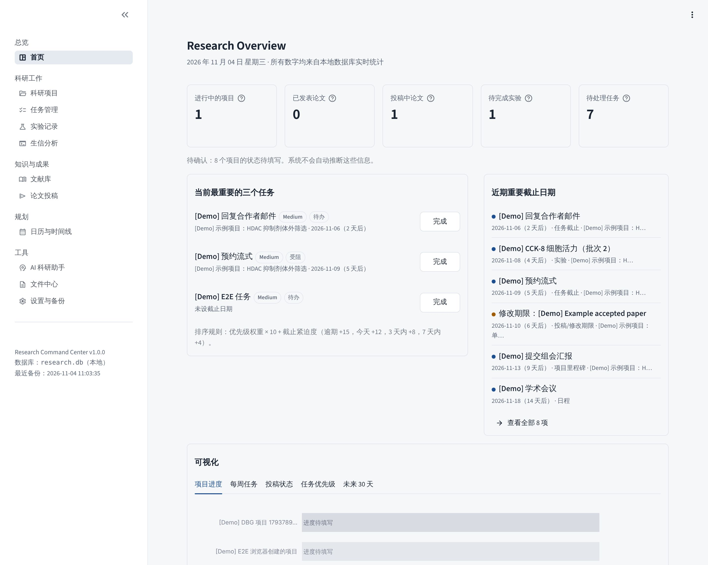

# Personal Research Command Center

本地运行的个人科研指挥中心：把科研项目、文献、实验、生信分析、论文投稿、任务、日历和 AI 助手整合在一个 Dashboard 里。

- **数据全部在本机**：SQLite 单文件数据库，应用只监听 `127.0.0.1`，关闭了 Streamlit 使用统计上报。
- **不依赖付费 API**：所有基础功能离线可用；AI 助手是可选插件。
- **不碰原始文件**：PDF、WB 图片、测序文件、脚本、Word 稿件都只以“绝对路径”被引用和索引，系统从不修改、移动或删除它们。
- **不编造信息**：未确认的字段显示“待填写”，自动识别的文献信息标记“待核实”，投稿状态只能由您手动确认。



---

## 1. 安装与启动（一条命令）

前提：已安装 **Python 3.11 或更高版本**（Windows 安装时勾选 “Add python.exe to PATH”）。

| 系统 | 启动 | 关闭 |
|---|---|---|
| Windows | 双击 `start.bat` | 关闭命令行窗口，或按 `Ctrl+C`，或双击 `stop.bat` |
| macOS / Linux | `./start.sh` | 终端中 `Ctrl+C`，或 `./stop.sh` |

首次启动会自动创建虚拟环境 `.venv` 并安装依赖（约 1–3 分钟）；之后启动不再重复安装，只有 `requirements.txt` 变化时才会更新。启动后浏览器自动打开 <http://localhost:8501>。

可选参数：`start.bat --port 8600`（换端口）、`start.bat --no-browser`（不自动打开浏览器）。查看状态：`.venv\Scripts\python scripts\launcher.py status`。

手动方式（等价）：

```bash
python -m venv .venv
```

```bash
.venv/bin/python -m pip install -r requirements.txt
```

```bash
.venv/bin/python -m streamlit run app.py
```

## 2. 数据存放位置

| 内容 | 默认位置 | 说明 |
|---|---|---|
| 数据库 | `data/research.db` | 首次打开页面时自动创建，并写入三个预置项目 |
| 备份 | `data/backups/` | 自动备份 + 手动备份 |
| 脚本运行日志 | `data/logs/` | 仅在启用脚本执行后产生 |
| 上传的 PDF 副本 | `data/library/` | 只有您用“上传”按钮明确上传时才保存副本 |
| 导出的 Excel | `data/exports/` | 设置页“导出全部数据” |

`data/` 已被 `.gitignore` 排除，代码与数据分离。要把数据放到其他磁盘：复制 `config/settings.example.toml` 为 `config/settings.toml` 并修改 `data_dir` / `backup_dir`，或设置环境变量 `RCC_DATA_DIR` / `RCC_BACKUP_DIR`。**建议把 `backup_dir` 设到另一块磁盘。**

## 3. 备份与恢复

**自动备份**：应用启动时以及运行期间，距上次自动备份超过 24 小时就自动备份一次（`config/settings.toml` 中 `interval_hours` 可调，`0` 为关闭），自动备份保留最近 30 份。手动备份与“恢复前备份”永不自动删除。每份备份都经过 SQLite `integrity_check` 校验。

**一键备份**：双击 `backup.bat`（或 `./backup.sh`），或在应用中“设置与备份 → 立即备份”。

**恢复**（两种方式，恢复前系统都会先把当前数据库另存为 `*_pre-restore.db`，可随时撤销）：

1. 应用内：设置与备份 → 备份与恢复 → 选择备份 → 勾选确认 → 恢复。
2. 命令行（先关闭应用）：

```bat
restore.bat --list
```

```bat
restore.bat --latest
```

```bat
restore.bat --file "D:\RCC\data\backups\research_20261104_101500_manual.db"
```

**最简单的人工备份**：关闭应用后，直接复制 `data/research.db` 这一个文件即可。

## 4. 功能模块

| 模块 | 主要功能 |
|---|---|
| 首页 Research Overview | 五项核心指标、最重要的三个任务（排序规则公开）、近期截止日期、项目进度/每周任务/投稿状态/优先级/未来 30 天五个图表、最近文献与项目 |
| 科研项目 | 新建/编辑/归档/删除（有关联数据时禁止删除，只能归档）；详情页含概览、时间线与里程碑、任务、文献、实验、投稿与分析、文件 |
| 任务管理 | 跨项目任务、Critical/High/Medium/Low、状态流转（自动记录开始/完成时间）、逾期、四象限（规则可手动覆盖）、多条件筛选 |
| 文献库 | PDF 导入（只读，元数据只取自 PDF 内嵌信息与首页 DOI/PMID，不按文件名猜测）、查重（DOI/PMID/文件哈希）、全文检索（返回页码与上下文，支持中文）、笔记、项目关联、价值与局限、核实状态与可追溯来源、可选的 Crossref/PubMed 在线比对（只在点击时发送 DOI/PMID） |
| 实验记录 | 电子实验记录、批次、参数表与跨实验参数对比、附件路径引用与存在性检测、待开展列表、实验日历 |
| 论文投稿 | Draft → … → Published 及拒稿/转投/撤稿/暂停；每次状态变更都必须勾选确认，并写入状态历史；系统绝不按日期推断状态 |
| 生信分析 | 任务登记、脚本/数据/输出路径管理与检测、运行日志（可手动登记）、结果摘要；可选的本机脚本执行（默认关闭，见下） |
| 日历与时间线 | 月视图、周视图、近期列表；汇总任务截止、实验、投稿/修改期限、里程碑、考试、会议、个人目标 |
| AI 科研助手 | 模型配置（Claude / GPT / Gemini / 本地 Ollama 等）、按项目逐项授权数据范围、发送前预览完整内容、调用留痕；无需 API 的“离线科研体检” |
| 文件中心 | 登记单个文件或扫描文件夹（只读遍历），记录绝对路径、存在性、修改时间、大小；只读预览 Word/PDF/表格/文本/图片；“移出索引”不删除文件 |
| 设置与备份 | 数据位置、备份/恢复、Excel 导出、脚本执行开关与解释器路径、操作日志 |

**深色模式**：点击右上角 **⋮** → 选择 **Light / Dark / System**（选择会被浏览器记住）。默认跟随操作系统，Windows 默认浅色模式下即为浅色主题。

## 5. 初始数据说明（重要）

首次启动时自动写入三个预置项目，**只录入能从本仓库已有文件中追溯的事实**，并在“信息来源”字段注明出处：

| 项目 | 已录入的事实（来源） | 待填写 |
|---|---|---|
| NSCLC 乙酰化精准治疗综述 | 两篇姊妹综述 A/B 的方向、稿件署名、“投稿前定稿”阶段、作者待办与风险（`修改说明.md`，2026-10-31；`A/B_revised_clean.docx`）；两篇稿件登记为论文记录，**投稿状态为“待确认”** | 状态、进度、负责人、起止时间、科学问题、假说、目标期刊 |
| POGLUT1–NOTCH–mTOR 与局灶性癫痫研究 | 仅项目名称 | 其余全部（仓库中没有该项目的任何资料） |
| 本科阶段原创研究性论文选题 | 目标；选题委员会 8 份交付物已完成；修订后的最终推荐（先单独做 C02，C01 作为第二篇）；下一步与风险；对应里程碑（无日期）（`UG_Research_Topic_Committee/README.md`、`08_Final_Recommendation.md`，2026-11-04） | 状态（资料未写明）、课题是否已开始执行、进度、负责人、起止时间、科学问题、假说 |

三个项目的“当前状态”均为待填写：资料中没有明确写出，系统不会因为“有文件”就推断项目在进行中（因此首页“进行中的项目”初始为 0，请您确认后设置）。预置项目登记的“关键文件”是仓库上一级目录中真实存在的文件（只引用路径）。如果您把本软件放到别的位置，这些文件引用会显示“不存在”，可在文件中心重新登记。所有内容都可以编辑。

## 6. AI 助手（可选）

1. AI 科研助手 → 模型配置 → 选择预设（Anthropic Claude 默认模型 `claude-opus-5-5`；OpenAI / Gemini / Ollama 请填写其官方模型名）。
2. 配置 API Key（**不会写入代码或数据库**）：
   - 环境变量（推荐）：Windows 运行下面的命令，然后重启应用。

     ```bat
     setx RCC_ANTHROPIC_API_KEY "你的密钥"
     ```

   - 或选择“系统凭据管理器（keyring）”，在页面中输入一次，密钥保存在 Windows 凭据管理器 / macOS 钥匙串中。
3. 提问时选择项目，并**逐项勾选**允许 AI 读取的数据（项目简介、任务、文献笔记、实验记录、分析摘要、投稿记录），展开“预览”查看将发送的全部内容，勾选授权后发送。

AI 被要求只依据系统记录回答，并分为【事实】【推测】【建议】三部分；不读取、不上传任何原始文件；不能执行任何操作。未配置模型时，其他功能完全不受影响，也可以使用“离线科研体检”。

## 7. 脚本执行（生信第二阶段，默认关闭）

在“设置与备份 → 脚本执行”中开启后，才可以执行已登记的 `.R` / `.py` 脚本。每次执行前都会展示完整命令、工作目录、输入文件（含存在性）、输出路径与脚本 SHA-256，必须勾选确认；确认后脚本若被修改则拒绝执行。不经过 shell，输出写入日志。**运行成功也只标记为 Needs Verification**，需您核验结果后再改为 Completed。

## 8. Demo 数据与测试

Demo 数据与真实数据物理隔离，所有 Demo 记录以 `[Demo]` 开头：

```bash
.venv/bin/python scripts/make_demo_db.py --reset
```

```bash
RCC_DATA_DIR=demo_data .venv/bin/python -m streamlit run app.py --server.port 8502
```

运行测试（每个测试使用独立的临时数据库，不会触碰 `data/`）：

```bash
.venv/bin/python -m pip install -r requirements-dev.txt
```

```bash
.venv/bin/python -m pytest -q
```

## 9. 目录结构

```
research_command_center/
├── app.py                  # 入口（导航与全局样式）
├── start.bat / start.sh    # 一键启动        stop.*   关闭
├── backup.bat / backup.sh  # 一键备份        restore.* 恢复
├── requirements.txt
├── .streamlit/config.toml  # 主题（浅色/深色）、仅监听本机、关闭统计
├── config/settings.example.toml
├── rcc/                    # 应用代码
│   ├── config.py db.py models.py seed.py constants.py utils.py
│   ├── services/           # 业务逻辑（所有数据库读写都在这里）
│   │   └── ai/             # 模型配置、授权上下文、调用、离线体检
│   └── ui/                 # 主题、通用组件、图表、日历
├── views/                  # 11 个页面
├── scripts/                # 启动器、备份、恢复、初始化、Demo 数据
├── tests/                  # 110 个自动化测试
└── docs/                   # 数据库说明、测试报告、路线图、截图
```

更多文档：[数据库结构](docs/DATABASE.md) · [测试报告](docs/TEST_REPORT.md) · [路线图与扩展建议](docs/ROADMAP.md)

## 10. 常见问题

- **端口被占用**：`start.bat --port 8600`。
- **启动时提示找不到 Python**：安装 Python 3.11+ 并勾选 “Add python.exe to PATH”；不要使用 Microsoft Store 的 python 别名。
- **改了代码 / 升级后**：关闭再启动即可；数据库结构会自动补充新增列，旧数据保留。
- **“打开文件”按钮无反应**：只在本机运行时有效（调用系统默认程序打开，不会修改文件）。
